# ZPCards

Home Assistant dashboard cards, installed together as one HACS download:

| Card | Type | What it does |
| --- | --- | --- |
| [Budget Sankey Card](#budget-sankey-card) | `custom:budget-sankey-card` | Draws a budget as a sankey: total, groups, line items. Entries can start and end on set dates. |
| [Food stockpile](#prepping-cards) | `custom:food-stockpile-card` | Counts a household's food stock in days, in batches by best-before date. |
| [Water stockpile](#prepping-cards) | `custom:water-stockpile-card` | The same for bottled water. |
| [Cat stockpile](#cats) | `custom:cat-stockpile-card` | Counts the cats' wet and dry food in days, from each cat's meals. |
| [Meds streak](#meds-streak-card) | `custom:meds-streak-card` | Shows one medicine's last month as a calendar, with the current streak. |

<p>
  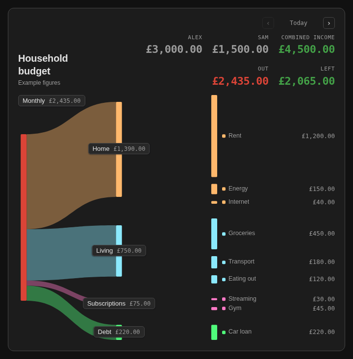
  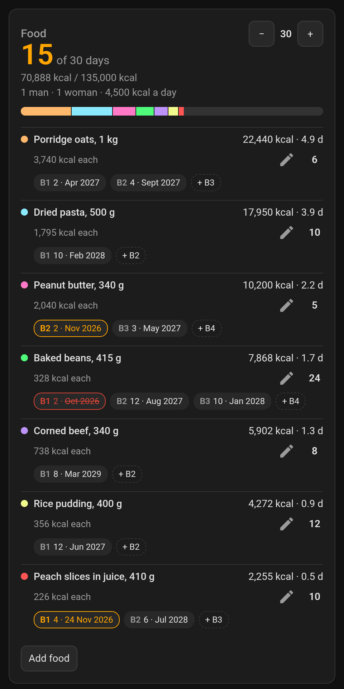
</p>

The cards need nothing but Home Assistant. They follow its theme and language, and fit a phone.

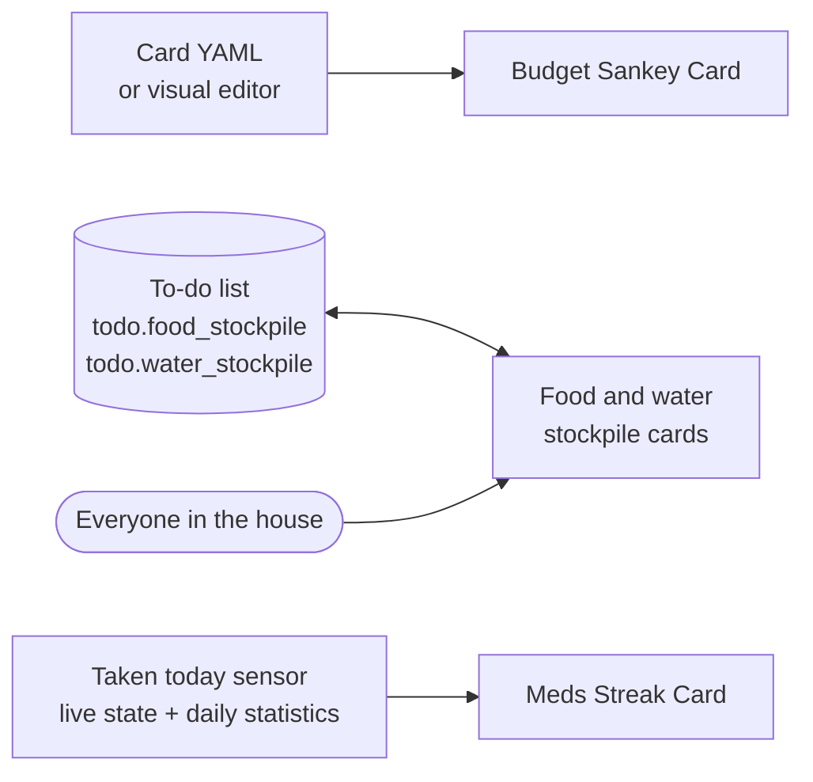

The budget card keeps its figures in its own config and reads no entities. The stockpile cards keep their stock in to-do lists, so every user and device sees the same numbers. The meds card reads a sensor and its long-term statistics, and stores nothing itself.

## Contents

- [Install](#install)
- [Budget Sankey Card](#budget-sankey-card)
- [Prepping Cards](#prepping-cards)
- [Meds Streak Card](#meds-streak-card)
- [Languages](#languages)
- [Development](#development)

## Install

**HACS:** use the button, then download ZPCards.

[](https://my.home-assistant.io/redirect/hacs_repository/?owner=matteo-pacini&repository=ZPCards&category=plugin)

Or add this repository as a custom repository of type *Dashboard*.

**Manual:** copy `zp-cards.js` to `config/www/`, then add `/local/zp-cards.js` as a JavaScript module resource.

One file holds every card. Each card appears in the dashboard's card picker once the file is loaded.

## Budget Sankey Card

Draws your budget as a sankey: total, groups, line items. Figures live in the card's config, not in entities. Entries can start and end on set dates, and the card lets you step through upcoming changes.

| Light theme | Upcoming change |
| --- | --- |
| 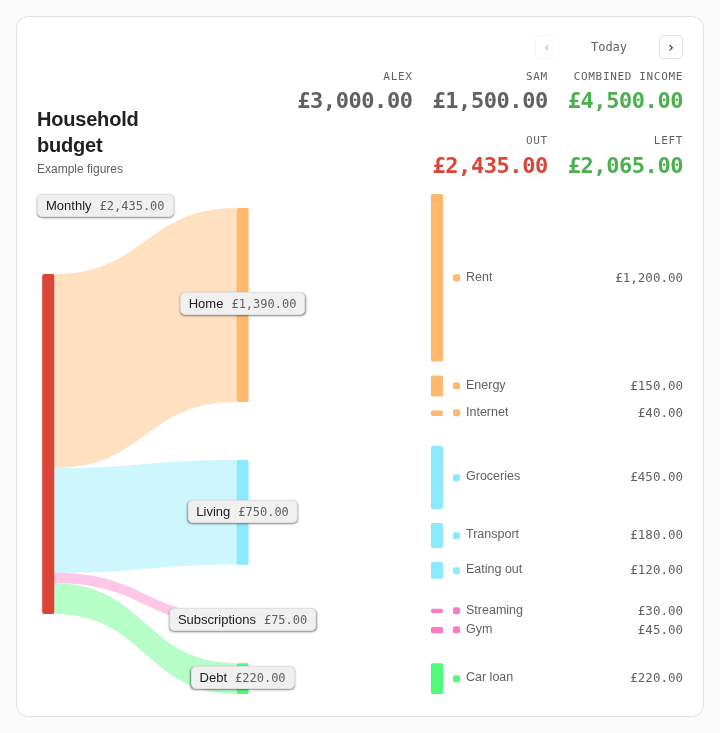 | 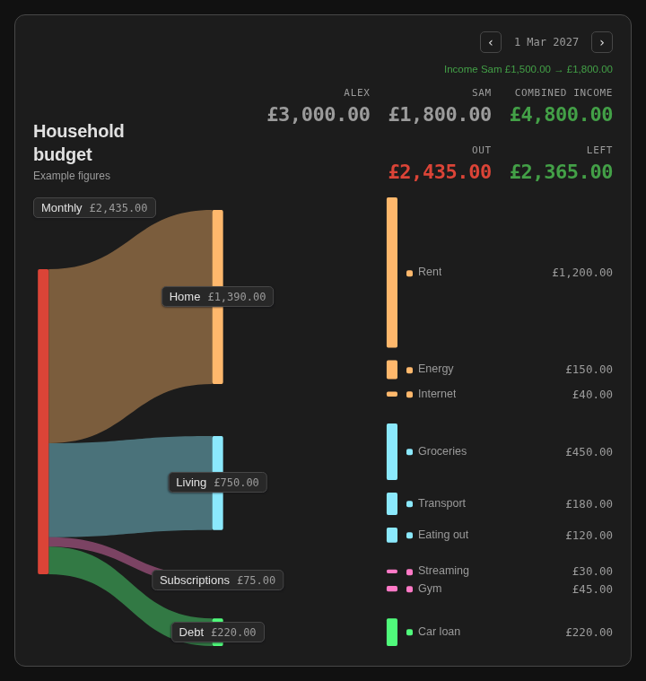 |

On a phone, the header stacks and the chart stays readable:

<p>
  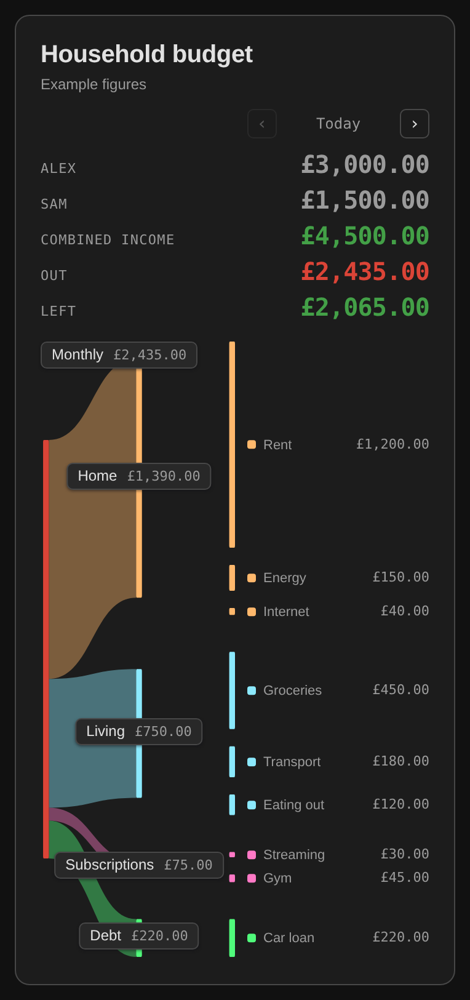
  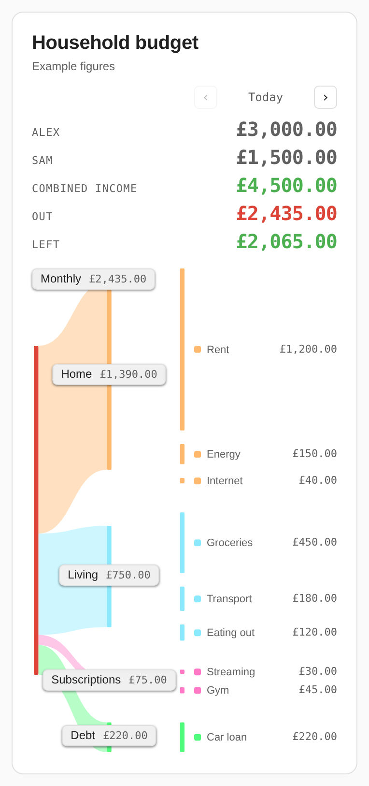
  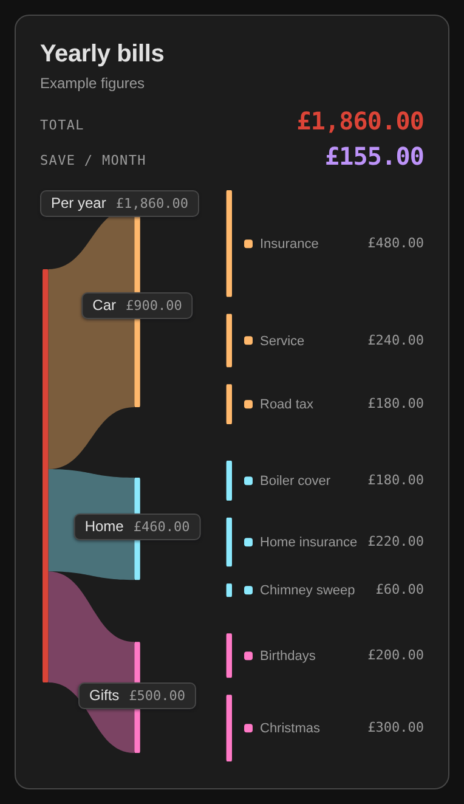
</p>

### Usage

Add the card from the dashboard editor and fill it in there, or write the YAML yourself.

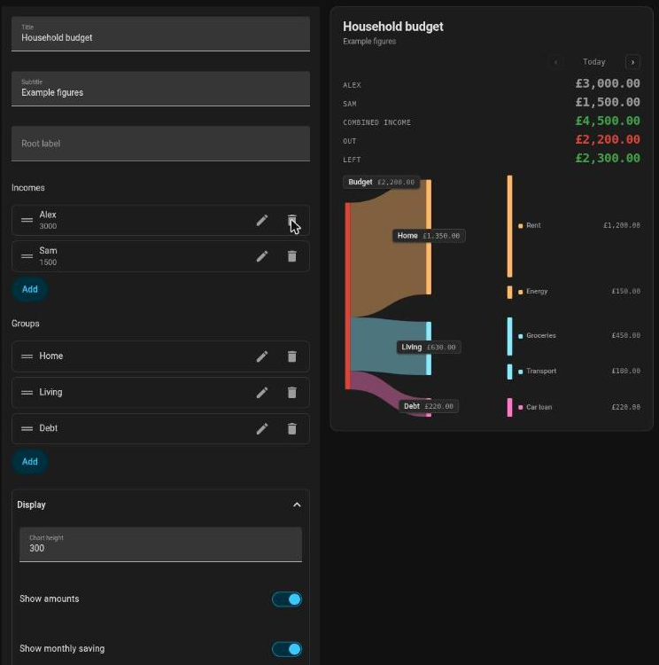

```yaml
type: custom:budget-sankey-card
title: Household budget
incomes:
  - [Alex, 3000]
  - { name: Sam, amount: 1500, until: 2027-02-28 }
  - { name: Sam, amount: 1800, from: 2027-03-01 }
groups:
  - name: Home
    items:
      - [Rent, 1200]
      - [Energy, 150]
  - name: Debt
    color: viz-7
    items:
      - { name: Car loan, amount: 220, until: 2030-09-30 }
```

Leave out `income` and `incomes` for a yearly card: it shows the total and the amount to put aside each month.

```yaml
type: custom:budget-sankey-card
title: Yearly bills
root: Per year
groups:
  - name: Car
    items:
      - [Insurance, 480]
      - [Service, 240]
  - name: Home
    items:
      - [Boiler cover, 180]
      - [Home insurance, 220]
```

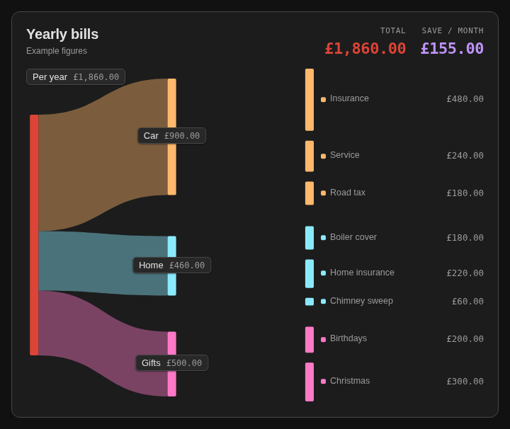

### Options

| Option | Default | Description |
| --- | --- | --- |
| `groups` | required | List of groups, see below |
| `income` | | Single income; the header shows in, out and left |
| `incomes` | | One entry per earner, instead of `income` |
| `title` | `budget` string | Card title |
| `subtitle` | | Line under the title |
| `root` | `budget` string | Label of the root node |
| `currency` | Home Assistant's | ISO 4217 code, such as `EUR` |
| `locale` | Home Assistant's | BCP 47 tag, such as `de-DE`, for amounts and dates |
| `accent` | `negative_color` | Colour of the root node and the outgoing total |
| `positive_color` | success colour | Income, a surplus, and good changes |
| `negative_color` | error colour | A shortfall and bad changes |
| `saving_color` | purple | Monthly saving on a yearly card |
| `palette` | built-in | List of colours for groups without their own `color`; repeats if shorter than `groups` |
| `theme` | Home Assistant's | Overrides for the card's look, see below |
| `strings` | translated | Overrides for the card's own text, see [Languages](#languages) |
| `show_amounts` | `true` | Show amounts beside line items |
| `monthly_saving` | `true` | Yearly card: show total / 12 |
| `chart_height` | `620` | Scale of the chart in pixels; the card grows if it needs more room |
| `income_label` | `in` or `combined_income` string | Income heading |
| `total_label` | `out` or `total` string | Total heading |
| `left_label` | `left` string | Left over heading |
| `saving_label` | `save_month` string | Monthly saving heading |
| `key` | `b` | Prefix for internal node IDs |

**Groups** take a `name`, a list of `items` and an optional `color`.

**Items and incomes** are a `[name, amount]` pair, or a `{name, amount}` mapping. Only the mapping form takes `from` and `until`: `YYYY-MM-DD` dates, both inclusive. Two dated entries with the same name read as one amount changing.

**Colours** are any CSS colour, or a token: `viz-1` to `viz-8`, `money-out`, `pending`, `accent`.

The visual editor covers everything above except `theme`, `strings`, `palette` and `key`, which it leaves as they are. Saving from it rewrites `[Rent, 1200]` pairs in the longer `name` and `amount` form. Its labels are in English, and it needs Home Assistant 2025.7 or later.

### Theme

The background, text, borders and fonts follow your Home Assistant theme. Override any of them under `theme`:

```yaml
theme:
  background: transparent
  font_heading: Georgia, serif
```

| Key | Default | Styles |
| --- | --- | --- |
| `background` | card background | Card surface |
| `border` | card border | Card outline |
| `divider` | divider colour | Chip and button borders |
| `highlight` | secondary text colour | Chip border on hover |
| `text` | primary text colour | Headings and hovered labels |
| `text_secondary` | secondary text colour | Labels and amounts |
| `text_muted` | disabled text colour | Dimmed labels on hover |
| `chip_background` | secondary background colour | Chips |
| `chip_shadow` | soft shadow | Chips, as a CSS `box-shadow` |
| `font_body` | body font | Body text |
| `font_heading` | heading font | Title |
| `font_mono` | code font | Figures |

### Strings

```yaml
strings:
  today: Adesso
  added: Nuovo {item} {amount}
```

Keys: `budget`, `in`, `combined_income`, `out`, `total`, `left`, `save_month`, `today`, `previous_change`, `next_change`, `added`, `removed`, `income`. Keep the `{item}`, `{amount}` and `{name}` placeholders.

## Prepping Cards

Three cards for a household stockpile: food, water and cat food. Each shows how many days the stock lasts for the people or cats you set, against a target number of days. Each item is kept in numbered batches by best-before date, so you can see what to eat first.

| Light theme | Water, target met |
| --- | --- |
| 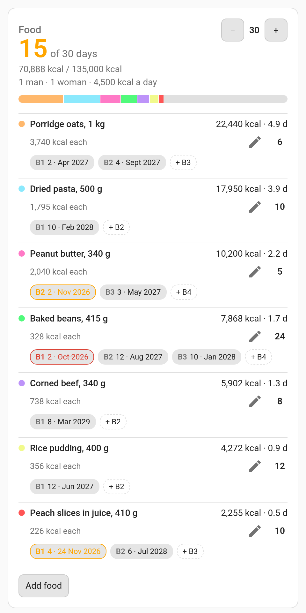 | 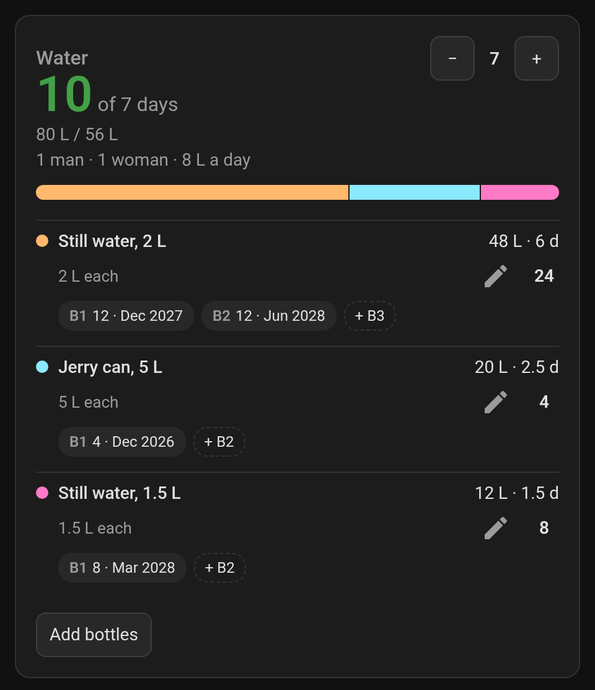 |

On a phone, long names and batches wrap:

<p>
  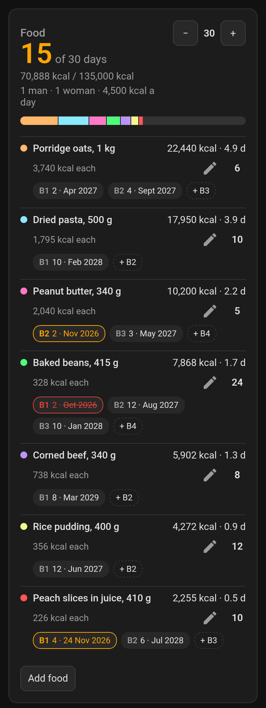
  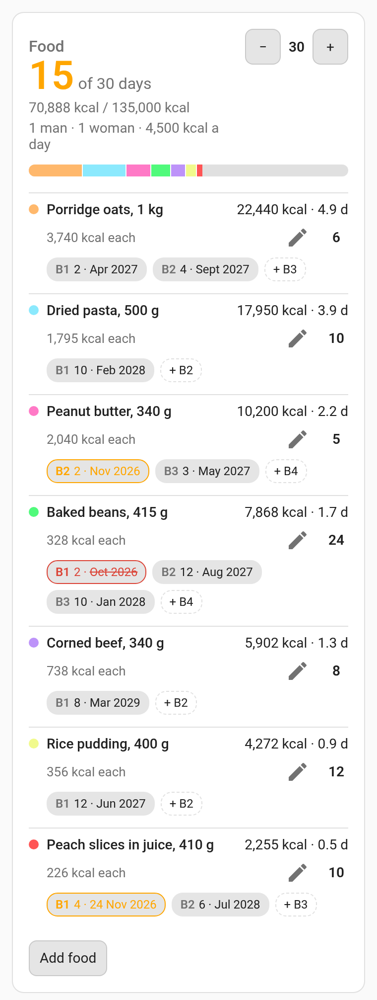
  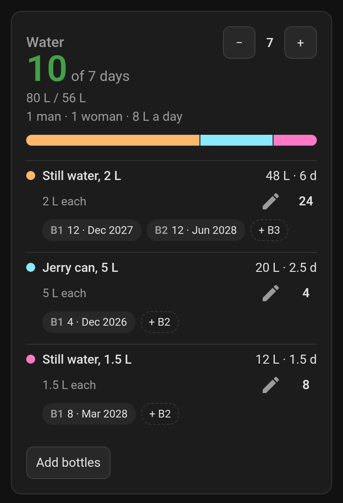
</p>

### Lists

Each card keeps its stock in a to-do list. By default:

| Card | List | Entity |
| --- | --- | --- |
| Food stockpile | Food stockpile | `todo.food_stockpile` |
| Water stockpile | Water stockpile | `todo.water_stockpile` |
| Cat stockpile | Cat stockpile | `todo.cat_stockpile` |

If a card's list doesn't exist yet, the card offers to create it as a Local To-do list. Only an admin can; anyone else is told which list to ask for.

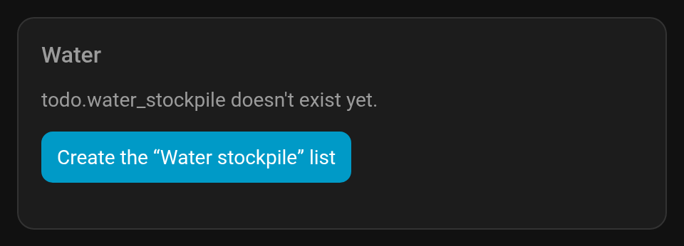

To create a list by hand: **Settings → Devices & services → Add integration → Local To-do**, named as in the table. The name sets the entity id, so *Food stockpile* becomes `todo.food_stockpile`. Any to-do list that can hold item descriptions works; point the card's `entity` at it.

### Usage

Add the cards from the dashboard editor and fill them in there, or write the YAML yourself. The visual editor has the list, the title, the number of men and women side by side (food and water only), and the locale. Its labels are in English.

```yaml
type: custom:food-stockpile-card
entity: todo.food_stockpile
men: 1
women: 1
```

```yaml
type: custom:water-stockpile-card
entity: todo.water_stockpile
men: 1
women: 1
```

```yaml
type: custom:cat-stockpile-card
entity: todo.cat_stockpile
```

Everything else happens on the card:

- **− and +** beside the big number change the target number of days. It starts at 30 for food and cats, and 7 for water. The number turns green once the stock covers the target.
- **Add food** or **Add bottles** opens a form. Food asks for the portion in grams and the calories per 100 g from the label; bottles ask for the litres each holds. A new item goes at the bottom of the list. The pencil on a row edits or removes it.
- **Batches** sit under each row, soonest to expire first: *B2 · 6 · Mar 2027* is batch 2, six of them, best before the end of March 2027. A batch turns amber within 30 days of its date and red once past it. The number beside the pencil is the row's total.
- **+ B3** adds a batch: its best-before month and how many. A batch with the same month gets them instead.
- **Tap a batch** to change its date or how many are left, or to remove it. Setting it to 0 removes it too.

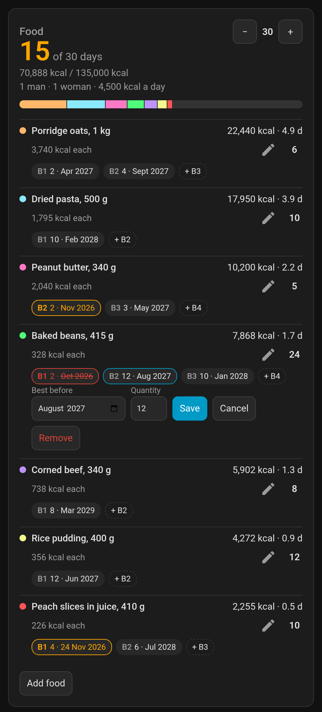

A batch keeps its number until it's gone, so you can write it on the tins. Numbers are per item, and a new batch takes the next one up.

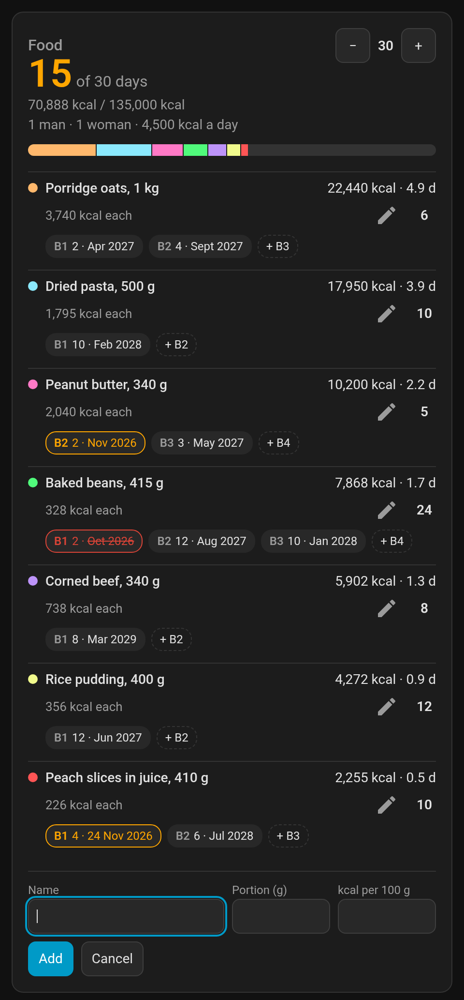

### Options

| Option | Default | Description |
| --- | --- | --- |
| `entity` | required | The to-do list that holds the stock |
| `title` | `Food`, `Water` or `Cats` | Card title |
| `men` | `1` | Adult men to feed, a whole number; food and water only |
| `women` | `1` | Adult women to feed, a whole number; food and water only |
| `locale` | Home Assistant's | BCP 47 tag, such as `de-DE`, for the card's text and numbers |
| `strings` | translated | Overrides for the card's own text, see [Languages](#languages) |

### Household

Set `men` and `women` to the adults in the household. The card adds up what they need a day, shows it under the totals (*1 man · 1 woman · 4,500 kcal a day*), and divides the stock by it to get days.

| Card | Per man | Per woman | Source |
| --- | --- | --- | --- |
| Food | 2,500 kcal | 2,000 kcal | NHS reference intakes for adults |
| Water | 4 L | 4 L | About a US gallon a day for drinking and basic hygiene, as FEMA advises |

For example, two men and one woman need 7,000 kcal and 12 L a day, so a 30-day food target is 210,000 kcal. Setting both to `0` makes the card ask for at least one person.

### Cats

The cat card counts wet and dry food separately, because a cat on both runs out when either one does. Its cats are set on the card, not in YAML, so anyone in the house can add a cat or change a meal.

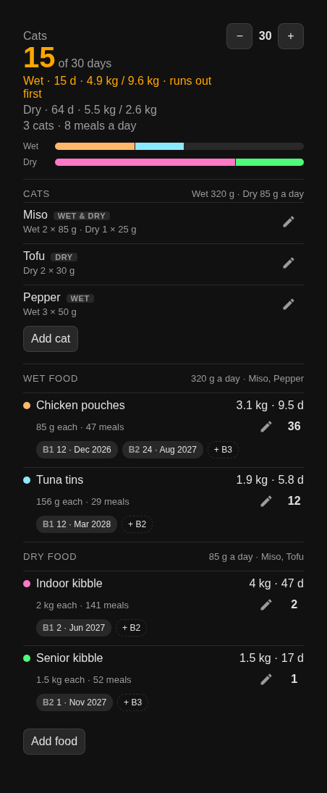

- **Add cat** asks for a name and a diet: wet, dry, or wet and dry. For each type it eats, give the meals a day and the grams a meal. The pencil beside a cat edits or removes it.
- **Add food** asks whether the item is wet or dry, and its grams each: the weight of one pouch, tin or bag.
- **Days** are worked out per type: the stock of that type divided by what all the cats eat of it a day. The big number is the shorter of the two, and the type that runs out first is marked. A type no cat eats never limits the days; its stock is still listed.
- **Meals**: the header shows how many meals the cats eat a day, and each row shows how many meals it holds, at the cats' average meal of that type.

For example, Miso eats 2 wet meals of 85 g and 1 dry meal of 25 g, Tofu eats 2 dry meals of 30 g, and Pepper eats 3 wet meals of 50 g. Together they eat 320 g wet and 85 g dry a day, in 8 meals.

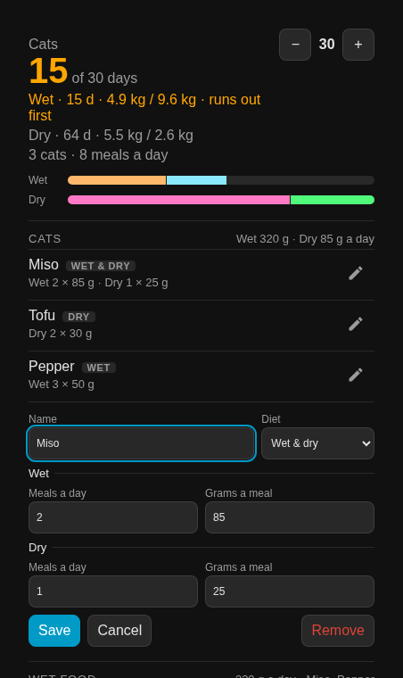

### Strings

```yaml
strings:
  food: Pantry
  per_day: "{amount} every day"
  men:
    one: "{n} adult man"
    other: "{n} adult men"
```

Keys: `food`, `water`, `of_days`, `days_short`, `per_day`, `each`, `men`, `women`, `target`, `day_less`, `day_more`, `edit`, `batch`, `new_batch`, `edit_batch`, `best_before`, `quantity`, `no_date`, `add_food`, `add_bottles`, `name`, `portion`, `kcal_per_100g`, `litres_each`, `add`, `save`, `cancel`, `remove`, `empty_food`, `empty_water`, `loading`, `nobody`, `missing`, `create`, `ask_admin`, `save_error`, `create_error`, and for the cat card `cats`, `cat_count`, `meals_a_day`, `meals`, `meal_amount`, `wet`, `dry`, `wet_dry`, `wet_food`, `dry_food`, `runs_out_first`, `nobody_eats`, `food_type`, `grams_each`, `grams_a_meal`, `meals_per_day`, `diet`, `add_cat`, `edit_cat`, `empty_cat_food`, `no_cats`. Keep the `{n}`, `{amount}`, `{name}`, `{batch}`, `{entity}` and `{error}` placeholders. `of_days`, `men`, `women`, `cat_count`, `meals_a_day` and `meals` change with the number: give one string for every number, or a form per [plural category](https://cldr.unicode.org/index/cldr-spec/plural-rules) (`one`, `few`, `many`, `other`, …) with `other` as the fallback.

### How the data is stored

Each food or bottle size is one to-do item. The item's name is what the card shows, and its description holds the figures and the batches as JSON:

```json
{"portion_g": 300, "kcal_per_100g": 439, "count": 4,
 "batches": [{"n": 1, "exp": "2027-03", "count": 3}, {"n": 2, "exp": "2027-09-15", "count": 1}]}
```

```json
{"litres": 2, "count": 16, "batches": [{"n": 1, "exp": "2028-06", "count": 16}]}
```

```json
{"type": "wet", "grams": 85, "count": 36, "batches": [{"n": 1, "exp": "2026-12", "count": 12}, {"n": 2, "exp": "2027-08", "count": 24}]}
```

`exp` is the best-before date: a month (`2027-03`, good to the end of March) or a day (`2027-09-15`), or `null` for none. `count` is the batches' total, kept for anything that reads only that. An item in the older format, with a `count` and no `batches`, shows as one batch with no date.

One more item per card, *Food stockpile settings*, *Water stockpile settings* or *Cat stockpile settings*, holds its target: `{"target_days": 30}`. The cat card's also holds its cats, each with only the types it eats:

```json
{"target_days": 30, "cats": [{"name": "Miso", "wet": {"meals": 2, "g": 85}, "dry": {"meals": 1, "g": 25}}, {"name": "Tofu", "dry": {"meals": 2, "g": 30}}]}
```

Items whose description is none of these are left alone and not shown, so the cards can share one list.

Items can be renamed or reordered in the to-do list itself; the card shows them in the list's order. Edit a description there only if it stays valid JSON; otherwise the card stops showing that item.

## Meds Streak Card

One card per medicine. It shows the last 30 days as a calendar that starts on Monday. Days in a row join into one bar, and today has a ring. The header shows the current streak and the best streak in the window, and a bar at the bottom shows how many of the last 30 days were taken.

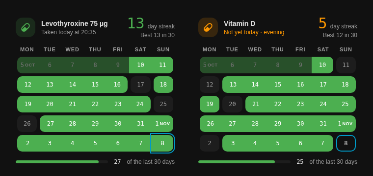

| Default light theme | A custom theme |
| --- | --- |
| 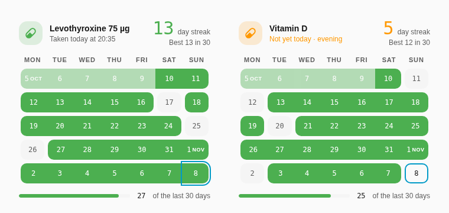 | 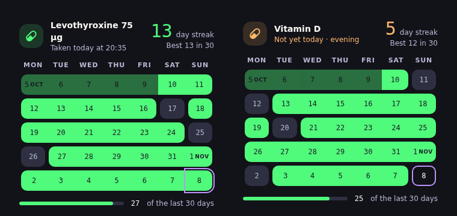 |

Colours come from your theme's own variables: green for taken, orange for a dose still due, the primary colour for today's ring. A theme that sets `--green-color`, `--orange-color` and `--primary-color` restyles the card with no card config.

<p>
  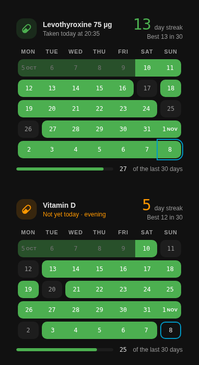
</p>

### What it needs

Each medicine needs a **taken today** sensor. It is `1` from the moment the dose is logged until midnight, then `0`. It also needs a `state_class`, so the recorder keeps its long-term statistics. The calendar reads past days from those statistics, which are never purged.

One way to set this up is to log each dose in a Date and time helper, and derive the sensor from it with a template:

```yaml
input_datetime:
  meds_vitamin_d:
    name: Vitamin D taken
    has_date: true
    has_time: true

template:
  - sensor:
      - name: Vitamin D taken today
        unique_id: meds_vitamin_d_taken_today
        state_class: measurement
        state: >
          {{ 1 if states('input_datetime.meds_vitamin_d')[:10] == now().date() | string else 0 }}
```

To log a dose, set the helper to now. A button or an automation can call:

```yaml
action: input_datetime.set_datetime
target:
  entity_id: input_datetime.meds_vitamin_d
data:
  timestamp: "{{ now().timestamp() }}"
```

### Usage

```yaml
type: custom:meds-streak-card
entity: sensor.vitamin_d_taken_today
logged: input_datetime.meds_vitamin_d
when: evening
```

The visual editor covers every option except `strings`. Its labels are in English.

### Options

| Option | Default | Description |
| --- | --- | --- |
| `entity` | required | The taken today sensor: above 0 once today's dose is logged |
| `name` | the sensor's name | Card title |
| `logged` | | An `input_datetime` with the time the dose was taken; the card shows it once today's dose is logged |
| `when` | | When the dose is due, such as `morning`; shown while today's dose is not logged |
| `icon` | `mdi:pill` | Icon beside the name |
| `days` | `30` | Days in the window: the calendar, the best streak and the count |
| `locale` | Home Assistant's | BCP 47 tag, such as `de-DE`, for the card's text, dates and numbers |
| `strings` | translated | Overrides for the card's own text, see below |

### How days are counted

- **Today** comes from the sensor's live state, so the card changes as soon as a dose is logged.
- **Past days** come from the sensor's daily statistics. A day counts as taken when the sensor's average over the day is above 0. The card does not use the day's maximum. The sensor drops to 0 at midnight, but the recorder still sees the 1 it had at the start of the next day. By maximum, the day after every dose would count as taken too. As a result, a dose logged after about 23:58 does not count for that day.
- **Days** start at midnight in Home Assistant's time zone, the same zone the recorder uses for its daily statistics.
- **The streak** is the run of taken days up to today. While today's dose is not logged yet, the run up to yesterday counts, so the streak only breaks after a whole day without a dose. The card works it out from the statistics each time it draws, and follows it back up to a year. Nothing has to run at midnight.

### Strings

```yaml
strings:
  not_yet_when: "Due {when}"
  streak:
    one: "day in a row"
    other: "days in a row"
```

Keys: `taken_today`, `taken_at`, `not_yet`, `not_yet_when`, `streak`, `best`, `of_last`, `state_taken`, `state_missed`, `state_pending`, `state_loading`, `summary`, `not_found`. Keep the `{time}`, `{when}`, `{n}`, `{days}`, `{name}`, `{count}`, `{streak}` and `{entity}` placeholders. `streak` and `of_last` change with the number: give one string for every number, or a form per [plural category](https://cldr.unicode.org/index/cldr-spec/plural-rules) with `other` as the fallback.

## Languages

<p>
  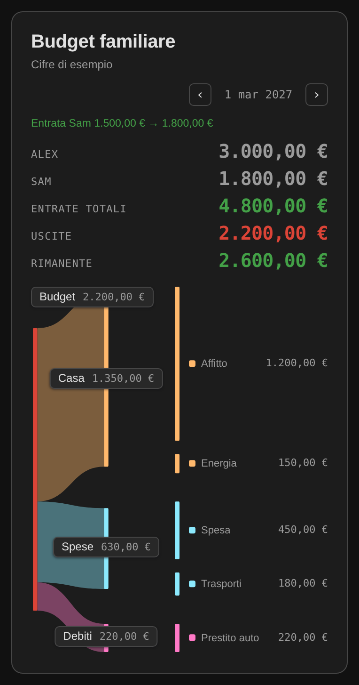
  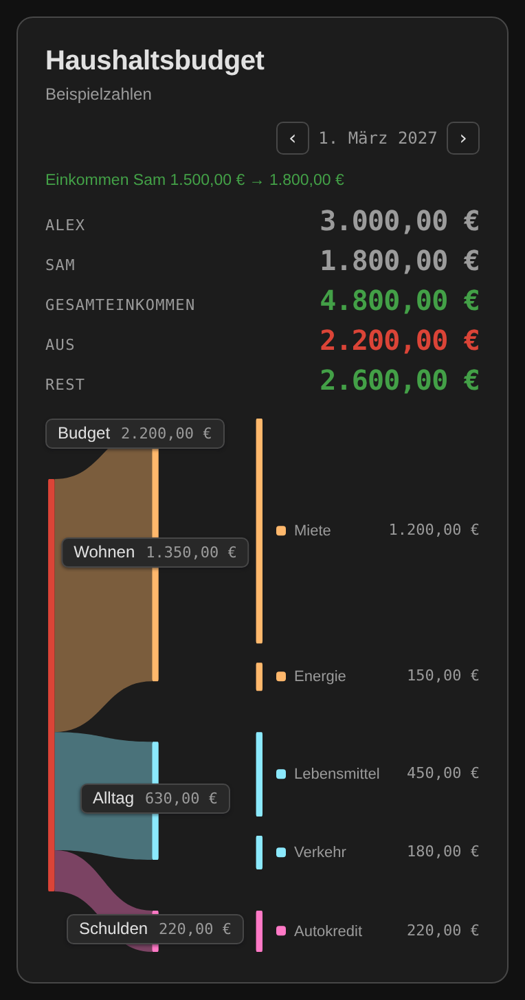
  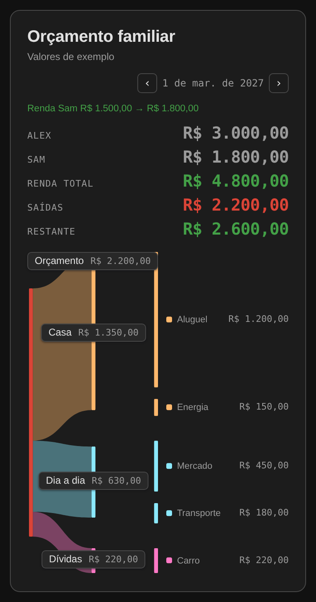
</p>
<p>
  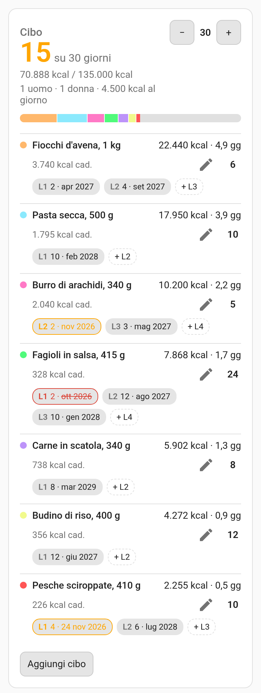
  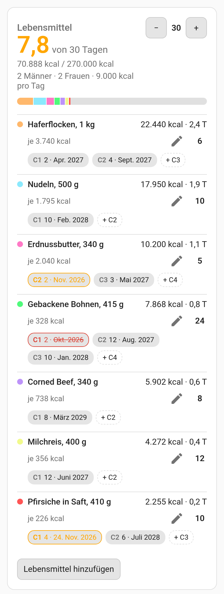
  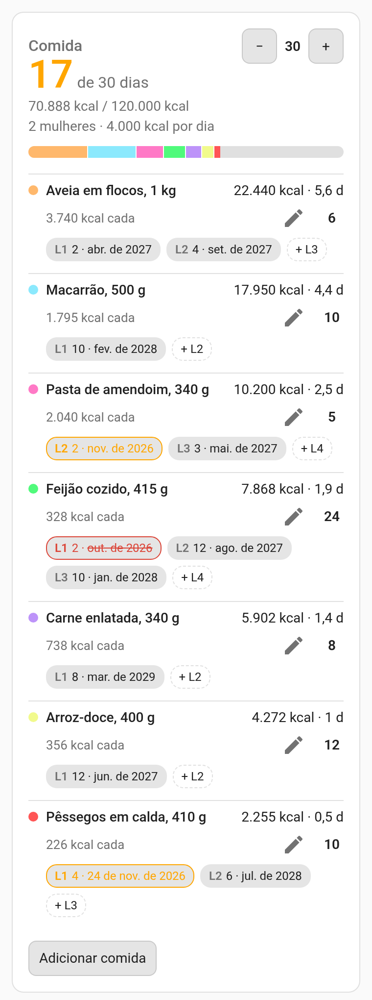
</p>
<p>
  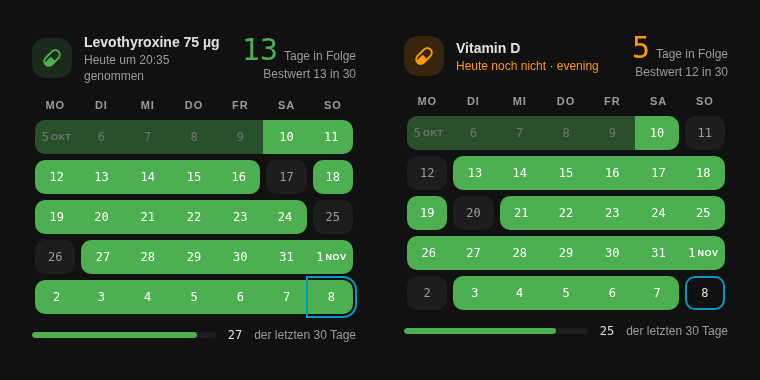
</p>

Every card's own text is available in English, Dutch, French, German, Italian, Polish, Portuguese, Brazilian Portuguese, Simplified Chinese, Spanish and Swedish. It needs no setup: a card uses its `locale` if set, otherwise your Home Assistant language.

A regional locale uses its regional text if there is one, then its language, so `pt-BR` gets Brazilian Portuguese and `de-AT` gets German. Traditional Chinese is not translated yet, so it shows English rather than Simplified. Anything untranslated falls back to English. Amounts, numbers and dates always follow the locale, whichever language the text is in.

- **Budget:** currency is separate from the locale. Set `currency`, or it follows Home Assistant.
- **Stockpile:** the names of your foods and bottles are shown as you typed them. Batch labels use the language's word for a batch, so B2 is C2 in German (*Charge*) and L2 in Italian (*lotto*); the number is the same in every language.
- **Meds:** weekday and month names follow the locale. The calendar always starts on Monday.

To change individual strings, set `strings` on the card. The keys are listed under each card: [budget](#strings), [stockpile](#strings-1), [meds](#strings-2).

## Development

| Path | Contents |
| --- | --- |
| `src/` | One script per card or family of cards; edit these |
| `zp-cards.js` | The file HACS installs, built from `src/` |
| `test/` | Tests, run with Node's built-in runner |
| `images/` | Screenshots used here |

`zp-cards.js` puts each script in its own block, so their top-level names don't clash. Rebuild it after changing `src/`, then run the tests. Node 24 or later:

```sh
node scripts/build.js
node --experimental-vm-modules --test test/*.test.js
```

CI runs the HACS check, fails if `zp-cards.js` is out of date, and runs the tests.

## License

MIT
